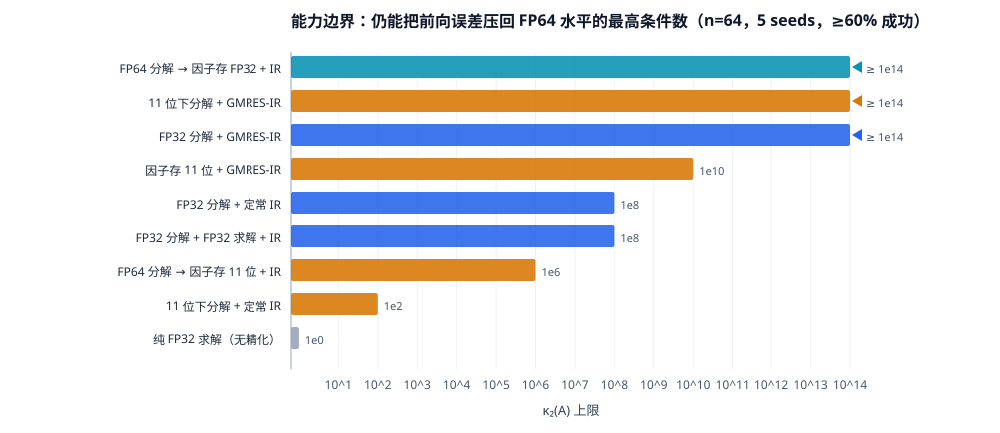

# 00 · 结论摘要

> 一页纸。细节在 [01](01-问题重构.md)–[07](07-研究路线.md)。

## 一句话

**FP32/FP64 混合精度在 LU 上的正确用法，不是"把因子压成低精度"，而是"用 FP32（或 11 位）
做 `O(n³)` 的分解，用 FP64 做 `O(n²)` 的残差，再用 GMRES 精化把误差拉回目标精度"——
前者能覆盖到 `κ≈1e8`，后者能覆盖到 `κ≈1e14`（即 FP64 自身的极限）。**

## 五条主要发现

1. **可行域是量出来的，而且和文献对得上。**
   FP32 分解 + 定常精化的断崖在 `κ≈1e8` 与 `1e9` 之间，与 Carson & Higham 2018 表 7.1
   的保证值 `κ≤1e8` 完全一致；换成 GMRES 精化后一直可用到 `1e14`，与文献的
   `κ ≪ u^{-1/2}u_f^{-1} ≈ 1.6e15` 前向界同量级。

2. **GMRES 精化不是"更聪明的迭代"，而是换了一类判据。**
   定常精化要求 `M⁻¹` 是收缩映射（`‖I-M⁻¹A‖<1`），GMRES 只要求它是**有界预条件**
   （`‖AM⁻¹-I‖` 有界）。后者在病态矩阵上容易满足得多。

3. **"量化即正则化"。** 低精度分解会自动丢弃 `σ < u_f‖U‖` 的奇异方向，
   于是 `‖M⁻¹‖` 随 `κ` **饱和**、`‖AM⁻¹-I‖` 被**封顶**。实测（n=48）：
   FP32 因子的 `‖M⁻¹‖` 在 `κ=1e12` 时只有 `1.3e9`（FP64 因子是 `1.9e11`）。
   这是 GMRES 精化能"越界"的机理。

4. **压缩因子 ≠ 低精度重算，而且两者的最优选择相反。**
   定常精化要"保真"→ 压缩 FP64 因子更好（`q11_ir` 到 `1e6`，`tf32_ir` 只到 `1e2`）；
   GMRES 精化要"有界"→ 低精度重算更好（`tf32_gir` 到 `1e14`，`q11_gir` 只到 `1e10`）。
   **工程规则：要低精度就重算，不要压缩。**

5. **只要目标是 FP64，`κ=1` 的矩阵也需要精化。**
   结构良好的矩阵（对角占优、MNA、Laplace）`κ` 只有 `1e1–1e4`，
   但纯 FP32 仍然差 8–9 个数量级——因为 FP32 的相对误差 `6e-8` 本身就达不到 FP64 的 `1e-16`。
   2–3 步定常精化的代价是 `O(n²)`，这是性价比最高的一档。

## 能力边界（n=64，5 seeds，≥60% 成功率）

| 配置 | 可用 `κ` 上限 | 迭代步数 | 相对纯 FP64 的加速潜力 |
|---|---|---|---|
| 纯 FP32，无精化 | 任何 `κ` 都不够 | — | 2×，但只能得到 FP32 精度的解 |
| FP32 分解 + 定常精化 | `1e8` | 3–14 | ~1.8×（`n≥1024`） |
| **FP32 分解 + GMRES 精化** | **`1e14`** | 4–107 | **1.2–1.95×** |
| 11 位分解 + GMRES 精化 | `1e14` | 80–130 | 4–7×（`n≥1024`） |
| FP64 分解→因子存 FP32 + 定常精化 | `1e14` | 3–8 | ~1.9×（带宽减半） |

> **加速比有前提**：精化是 `O(n²)`，分解是 `O(n³)`，`k` 步精化相当于 `6k/n` 次分解。
> 要 `n > 12k`（FP32）或 `n > 6.9k`（11 位）才划算。
> **`n=64` 时 11 位 + GMRES 反而慢一倍（0.55×）**——小规模下低精度的收益是面积与能耗，不是时间。
> 完整表格见 [04 篇 4.8](04-实验证据.md)。

## 三条设计规则

> **R1 只降 `O(n³)` 的精度。** 其余槽位（求解、残差、更新）降了省不出时间，反而丢掉误差锚点。
>
> **R2 残差必须全精度，且它是全芯片唯一的 FP64 通路。** 算力需求只有 `O(n²)`，
> 面积占比随 `n` 增大而下降（约 `12k/n`）。
>
> **R3 要低精度就重算，不要压缩。** 压缩保留病态谱，会让 GMRES 失效。

## 选型速查

| 你的目标 | 推荐 | 预期 |
|---|---|---|
| 要 FP64 结果，`κ<1e8` | FP32 分解 + 定常精化（2–4 步） | 1.8–1.9× |
| 要 FP64 结果，`κ>1e8` | FP32 分解 + GMRES 精化 | 1.2–1.9× |
| 只要省带宽/容量（稀疏、多右端） | FP64 分解 + 因子存 FP32 + 定常精化 | 带宽减半，精度不掉 |
| 要 FP32 结果，`κ<1e6` | 11 位分解 + 精化 | 4–7× |
| 没有 FP64 单元 | Ozaki 拆分 / 双倍精度，用 `k²` 次低精度换精度 | 取决于硬件比 |
| `κ>1e14` | 无解，改用正则化（Tikhonov）而非更快的 LU | — |

## 适合用 LU 加速的应用（按综合分排序）

1. **大规模 MIMO / 阵列信号处理**（24/25）：`κ` 可设计、精度富余大、实时性强。
2. **隐式 PDE / CFD**（21/25）：精度容限最宽（非精确 Newton 本来就用松容差）。
3. **隐式深度网络 / DEQ**（20/25）：`κ` 最小，与 AI 加速器数据通路复用度最高。
4. **电路仿真 SPICE**（19/25）：与 IC 设计最相关，但精度要求最严，适合"保守配置"。
5. **稀疏直接法的稠密面板**（19/25）：不是应用，是所有上层加速的地基。

**不适合**：Transformer 注意力（没有线性系统）、一般 DNN 训练（没有 LU）、
病态反问题（红区）、`n<64`（精化开销占主导）。

## 研究切入点（详见 [07](07-研究路线.md)）

- **首选**：分块内嵌精化（把残差补偿嵌进 tile LU 循环，省一趟 `O(n²)` 访存）。
- 次选：精度分配的最优化（查找表 + 在线 `κ` 估计选择器）。
- 新颖但地形复杂：量化视角下的 LU 因子存储（文献确实空白，但 MX-Cholesky 2026 已占 Cholesky 一角）。

## 这份材料的边界

所有数字来自**纯 Python 逐操作舍入模拟**（n≤576，稠密/带状），不含并行、通信、
真实张量核的累加行为。结论的**定性部分**（三条边界、正则化机理、压缩 vs 重算）
是稳的；**定量部分**（迭代数、加速比）依赖 `n` 与硬件吞吐比，只能当量级参考。
