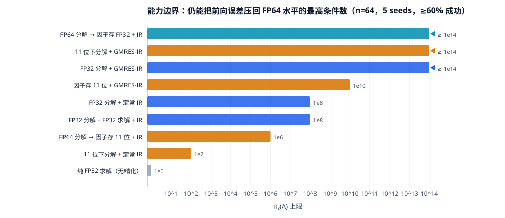
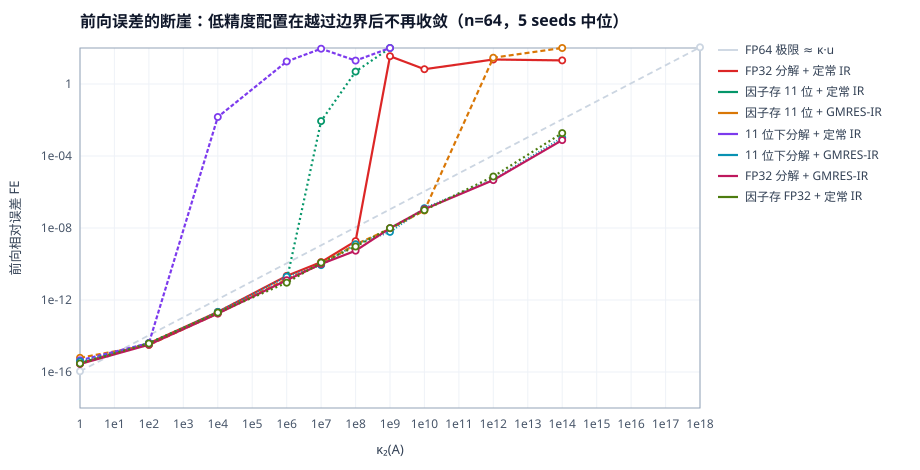
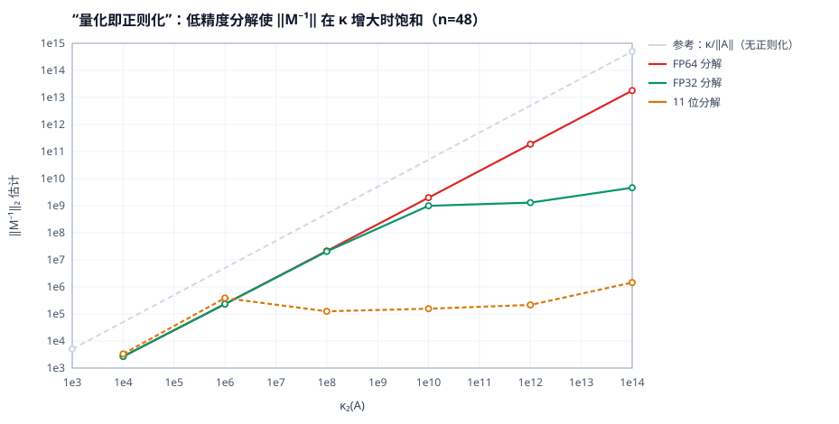
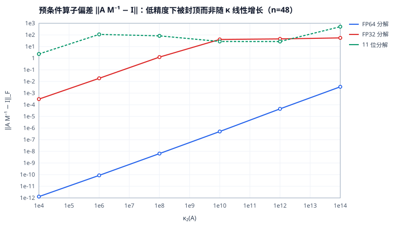
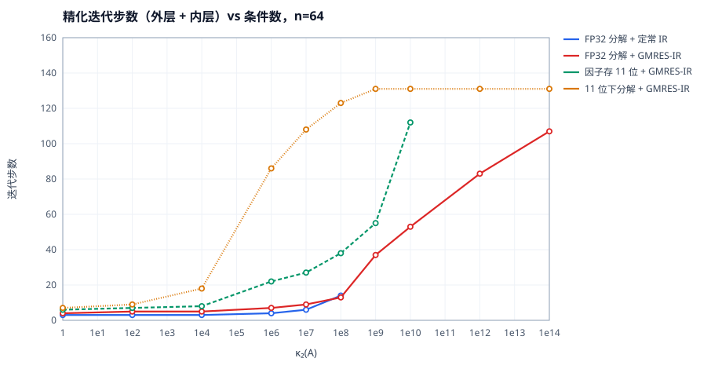
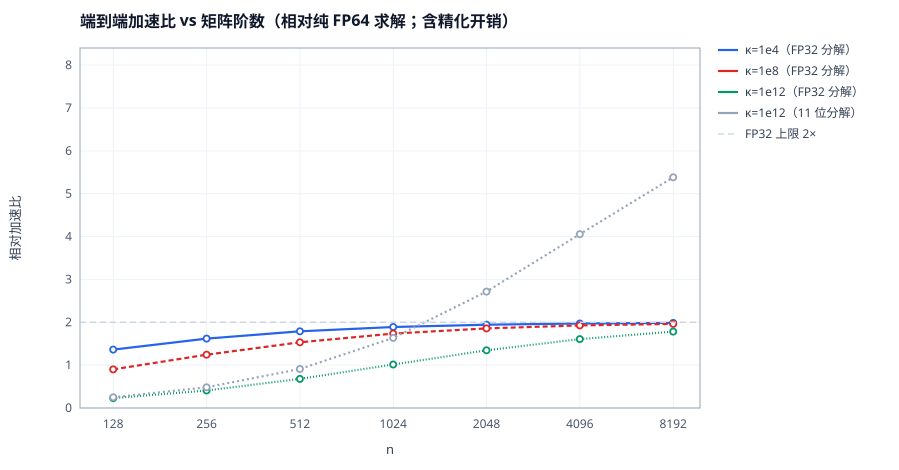

# 04 · 实验证据：可行域是量出来的

> 本篇记录全部数值实验的方法、原始数据与结论。代码在 [`code/`](../code/)，
> 原始数据在 [`results/scan.csv`](../results/scan.csv)（759 行）与
> [`results/reg.csv`](../results/reg.csv)，图在 [`figures/`](../figures/)。
> 全部可复现：`python3 code/run_experiments.py && python3 code/diag_regularization.py
> && python3 code/make_figures.py`。

## 4.1 模拟器：为什么用纯 Python 逐操作舍入

没有用 LAPACK/BLAS，而是在 Python 里**对每一次乘加显式舍入到目标精度**。理由：

1. **槽位可控**：可以独立设置分解、求解、残差三个精度，而 BLAS 只能整体切精度。
2. **可审计**：每个浮点运算都过一遍 `round_p(·)`，没有隐藏的扩展精度（x87 80 位之类）。
3. **正确性论证**：两个 `p ≤ 27` 位的数之积在 double 中**精确**（`24+24=48 < 53`），
   所以 `round_p(a*b + c)` 等价于"单次舍入的 FMA"，没有二次舍入问题。

代价是规模：纯 Python 只做到 `n=576`（带状稀疏时靠 `if lik != 0` 跳过），
`n=64` 的稠密扫描是主力。**这决定了本篇结论的适用范围：小规模、稠密、双精度模拟。**

## 4.2 实验设计

| 维度 | 取值 |
|---|---|
| 矩阵族 | `κ` 受控随机阵（`UΣVᵀ`，正交基两遍 MGS）、1D/2D Laplacian、对角占优、类 MNA 稀疏阵 |
| 规模 | `n=64`（主），`n=32/128`（抽样），`n=64/256/576`（2D Laplace） |
| 条件数 | `κ ∈ {1, 1e2, 1e4, 1e6, 1e7, 1e8, 1e9, 1e10, 1e12, 1e14}` |
| 种子 | 5 个（`κ` 扫描），2 个（结构矩阵） |
| 变体 | 11 个（见下表） |
| 指标 | 前向误差比 `FE/FE_FP64`、残差、迭代数、增长因子、FP64 等价代价 |

11 个变体（`u_f` 分解精度 / `u_s` 存储精度 / `u_t` 求解精度）：

| 变体 | `u_f` | `u_s` | `u_t` | 精化 | 说明 |
|---|---|---|---|---|---|
| `fp64` | 53 | 53 | 53 | 无 | 基准 |
| `fp32` | 24 | 24 | 53 | 无 | 纯 FP32 求解 |
| `fp32_ir` | 24 | 24 | 53 | 定常 | 三精度 IR |
| `fp32_ir_s32` | 24 | 24 | **24** | 定常 | 三角求解也降精度 |
| `fp32_gir` | 24 | 24 | 53 | GMRES | **推荐方案** |
| `q24_ir` | 53 | **24** | 53 | 定常 | FP64 分解→因子压 FP32 |
| `q24_gir` | 53 | **24** | 53 | GMRES | 同上 + GMRES |
| `q11_ir` | 53 | **11** | 53 | 定常 | 因子压到 11 位 |
| `q11_gir` | 53 | **11** | 53 | GMRES | 同上 + GMRES |
| `tf32_ir` | **11** | 11 | 53 | 定常 | 11 位下重算 |
| `tf32_gir` | **11** | 11 | 53 | GMRES | 11 位重算 + GMRES |

## 4.3 结果一：能力边界（表 A / 图 1）

中位前向误差比 `FE/FE_FP64`（`≈1` 表示达到 FP64 水平，`>10` 视为失败）：

| 配置 | κ=1e2 | 1e4 | 1e6 | 1e7 | 1e8 | 1e9 | 1e10 | 1e12 | 1e14 |
|---|---|---|---|---|---|---|---|---|---|
| `fp32`（无精化） | 2.3e8 | 2.5e8 | 1.4e8 | 1.5e8 | 1.7e8 | 4.9e8 | 5.4e7 | 2.0e6 | 1.2e4 |
| `fp32_ir` | 0.84 | 1.0 | 1.6 | 1.4 | **2.0** | 7.5e9 | 9.0e7 | 6.3e6 | 3.0e4 |
| `fp32_ir_s32` | 0.68 | 1.0 | 1.6 | 1.8 | **2.9** | 3.5e9 | 2.8e8 | 1.1e7 | 3.4e4 |
| `fp32_gir` | 0.70 | 1.1 | 1.2 | 1.1 | 0.69 | 1.8 | 1.2 | 1.7 | **1.1** |
| `q24_ir` | 0.70 | 1.0 | 0.89 | 1.1 | 1.5 | 2.9 | 1.6 | 2.3 | **1.3** |
| `q11_ir` | 0.87 | 0.92 | **1.0** | 1.0e8 | 7.3e9 | 3.7e12 | 9.6e13 | 9.1e18 | 5.3e21 |
| `q11_gir` | 0.72 | 1.2 | 1.2 | 1.1 | 1.3 | 1.2 | **1.2** | 1.3e7 | 7.1e7 |
| `tf32_ir` | **0.66** | 1.5e11 | 1.7e12 | 7.1e11 | 3.1e10 | 2.1e11 | 2.3e8 | 2.7e6 | 5.4e4 |
| `tf32_gir` | 0.86 | 1.3 | 1.6 | 0.96 | 1.4 | 1.4 | 1.4 | 1.7 | **1.6** |



> **图 1** 每个配置"仍能把前向误差压回 FP64 水平"的最高 `κ`（≥60% 成功率）。
> 青/蓝/橙三条都顶到 `1e14`——那是 FP64 自身的地板，不是算法的极限。



> **图 2** 绝对前向误差 vs `κ`。灰虚线是 FP64 的理论地板 `κ·u₆₄`。
> 所有配置在各自边界内**贴合这条线**（说明它们确实达到了 FP64 质量），
> 越过边界后垂直上升（不再收敛）。

## 4.4 结果二：正则化机理（图 4 / 图 5）



> **图 4** `‖M⁻¹‖` vs `κ`。FP64 因子严格贴合 `κ/‖A‖` 参考线；
> FP32 因子在 `κ≈1e10` 后**饱和**；11 位因子更早饱和（`κ≈1e6`）。
> 饱和意味着因子已经"看不见"更小的奇异方向——这是量化自带的正则化。



> **图 5** `‖AM⁻¹ - I‖_F`。FP64 因子随 `κ` 单调增长（最终 ~1e-3 量级仍可用）；
> FP32 因子在 `κ>1e10` 后被**封顶在 ~50**；11 位因子在几十到几百之间波动。
> **"封顶"正是 GMRES 能收敛的原因**：它需要预条件偏差有界，而不是预条件精确。

## 4.5 结果三：迭代代价（图 3）

| 配置 | κ=1e6 | 1e8 | 1e9 | 1e10 | 1e12 | 1e14 |
|---|---|---|---|---|---|---|
| `fp32_ir`（仅外层） | 4 | 14 | 3 | 3 | 3 | 3 |
| `fp32_gir`（外+内） | 7 | 13 | 37 | 53 | 83 | 107 |
| `q11_gir` | 22 | 38 | 55 | 112 | 157 | 155 |
| `tf32_gir` | 86 | 123 | 131 | 131 | 131 | 131 |



> **图 3** 迭代数随 `log κ` 近似线性增长，并被 `n`（全 GMRES 至多 `n` 步）截断。
> 注意 `tf32_gir` 即使在 `κ=1e6` 也要 86 步——**正则化越强，预条件偏差越大，
> GMRES 越费力**。省下的 `n³` 会被多出来的 `O(n²)` 迭代部分抵消，`n` 越大越划算。

## 4.6 结果四：结构矩阵

| 矩阵 | `n` | `κ₁` | `fp32` | `fp32_ir` | `fp32_gir` | `tf32_gir` |
|---|---|---|---|---|---|---|
| 对角占优 | 64 | 2.7 | 2.2e8 | 1.3 | 0.54 | 0.96 |
| 类 MNA 稀疏 | 64 | 12 | 1.8e8 | 7.8 | 0.75 | 1.00 |
| 1D Laplace | 200 | 2.0e4 | 4.2e8 | 1.4 | 1.6 | 1.3 |
| 2D Laplace | 576 | 3.7e2 | 6.0e8 | 0.61 | 0.89 | 0.67 |

（表中为 `FE/FE_FP64`）

**关键观察**：这些矩阵的 `κ` 只有 `1e1–1e4`，远在"绿区"内，但**纯 FP32 仍然差 8–9 个数量级**。
原因是 `κ` 小只保证"相对误差不被放大"，不保证 FP32 的 `6e-8` 相对误差就够用——
目标是要 FP64 的 `1e-16`。所以：

> **只要目标精度是 FP64，哪怕 `κ=1`，也必须至少做一次精化。**
> 这不是"病态矩阵才需要"的技术。

一次定常精化（2–3 步）就能把误差拉回 FP64 水平，代价是 `O(n²)`——
在结构良好、`κ` 小的场景（电路、PDE）里，这是性价比最高的配置。

## 4.7 结果五：增长因子

实测最大增长因子：随机阵 `ρ ≈ 1.0–1.6`，对角占优 `ρ ≈ 1.00`，稀疏 MNA `ρ ≈ 1.00`，
2D Laplace `ρ ≈ 1`（带状）。**partial pivoting 在这些矩阵上没有制造增长问题。**

> 一个意外的教训：Wilkinson 矩阵（经典的最大增长例子）在 FP32 下**完全精确**，
> 因为它的元素都是不超过 `2ⁿ` 的整数，`n ≤ 24` 时 FP32 能精确表示，
> 所有运算无舍入。**用整数矩阵测数值稳定性会得到假阳性结论。**

## 4.8 结果六：代价与加速比（图 6）

代价模型（FP64 等价 flops）：

```
C = (2/3)n³ / s(u_f)                      分解
  + k_outer · [ 2n²/s(u_t) + 2n² ]        每次外层：三角求解 + 残差
  + k_inner · [ 2n² + 2n²/s(u_t) + 2n²·k ] 每次内层：matvec + 预条件 + 正交化
```

其中 `s(u)` 是相对 FP64 的吞吐倍率（本文取 FP32=2、11 位=8）。

**摊销条件（很关键）**：精化每步是 `4n²`，分解是 `(2/3)n³`，所以 `k` 步精化相当于
`6k/n` 个分解。要拿到加速（`>1`），需要

```
n > 12k    （FP32 分解，s=2）        n > 6.9k   （11 位分解，s=8）        (4.1)
```

把实测迭代数代进去：

| `n` | FP32，`k=5`（κ=1e4） | FP32，`k=13`（κ=1e8） | FP32，`k=83`（κ=1e12） | 11 位，`k=18` | 11 位，`k=131` |
|---|---|---|---|---|---|
| 64 | **1.03** | 0.58 | 0.12 | **0.55** | 0.08 |
| 256 | 1.62 | 1.24 | 0.41 | 1.83 | 0.31 |
| 1024 | 1.89 | 1.74 | 1.01 | 4.34 | 1.12 |
| 8192 | 1.99 | 1.96 | 1.78 | 7.24 | 4.53 |

**这张表推翻了"低精度总是更快"的直觉**：`n=64` 时，11 位分解 + GMRES 精化
反而比纯 FP64 慢一倍（0.55×）。**小规模下低精度的收益是面积与能耗，不是时间。**



> **图 6** 端到端加速比随 `n` 增长并趋于渐近值：FP32 分解 → ~1.9×（上限 2×），
> 11 位分解 → ~7×（上限 8×）。`κ=1e12` 的曲线低 5–10%，因为它要 ~100 步精化。
> **小 `n` 时精化开销吃掉收益**（`n=128` 只有 1.6×），这是 `O(n²)` 对 `O(n³)` 的必然。

## 4.9 七条结论

1. **断崖在 `≈6/u_f`**：FP32-IR 在 `1e8` 与 `1e9` 之间失效（理论充分条件给 `1.7e7`，
   实际更宽松 5–6 倍）。
2. **GMRES-IR 把上界推到 `1/u_r`**：FP32 因子 + FP64 GMRES 一直可用到 `1e14`，
   再往上受 FP64 自身的 `κ·u` 限制，不是算法问题。
3. **存储量化比计算量化安全**：FP64 分解 + 因子存 FP32（`q24_ir`）能用到 `1e14`，
   而且只需要定常 IR。**如果只是想省带宽/容量，压因子存储是最稳的**。
4. **压缩因子 ≠ 低精度重算**：`q11_ir` 到 `1e6`，`tf32_ir` 只到 `1e2–1e4`；
   反过来 `tf32_gir` 到 `1e14`，`q11_gir` 只到 `1e10`。**两条路线的最优选择是相反的**，
   因为 IR 要"保真"，GMRES 要"有界"。
5. **量化自带正则化**：`‖M⁻¹‖` 饱和、`‖AM⁻¹-I‖` 封顶，这是 GMRES-IR 越界的机理。
6. **目标精度决定一切**：`κ=1` 的矩阵也需要精化，因为目标是 FP64；
   反过来说，如果只想要 FP32 结果，11 位分解可以给 8×。
7. **代价随 `n` 摊销**：`n≥1024` 时精化开销 < 5%，加速比接近硬件的吞吐比。

## 4.10 这些结论不能外推的地方

- **规模**：`n=64` 的迭代数会被 `n` 截断（全 GMRES 至多 `n` 步），大 `n` 时可能更多。
- **稀疏**：本文用自然序消元，未测 fill-in、符号分解、超节点；稀疏 LU 的 `κ` 估计更难。
- **并行**：代价模型只算 flops，没算通信、访存、精度切换的流水线气泡。
- **常数**：`s(u)` 取 2/8 是 H100 量级；消费级 GPU 上 FP64 极慢，比可达 32–64。
- **模拟器**：`round_p(a*b+c)` 用 double 中转，理论上存在二次舍入（概率极低），
  但不等同于真实 FMA 的逐位行为。
