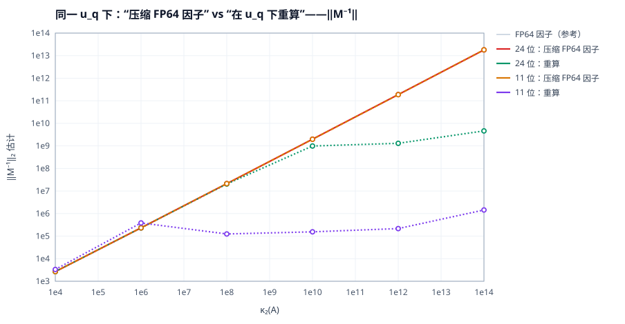
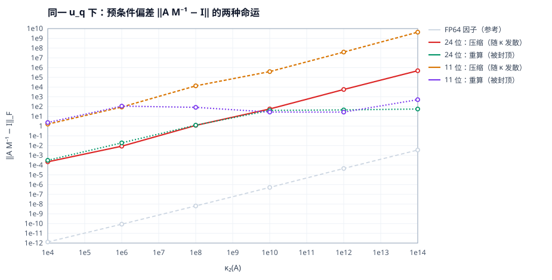

# 09 · 论文：能推导出的结论

> 前八篇是"把可行域量出来"。本篇回答：**这些结果里，哪些可以写成命题、哪些只能叫经验律，
> 以及一篇论文该怎么立论。** 每条结论标注 `【命题】/【推论】/【经验律】/【已有】`。

## 9.0 一句话主张（论文的钩子）

> **在混合精度 LU 里，因子的"精度"不是唯一的变量——同样低精度的因子，
> "压缩"和"重算"会得到同一个向后误差，却落在谱的两端，从而决定哪种精化能用。**

这一条把"量化"这个来自深度学习的直觉，翻译成了一个**结构性的二分**，
也解释了为什么工业界的做法（HPL-MxP 用 fp16 重算 + fp64 GMRES 精化）是对的，
而"把 FP64 因子压成 FP16 省带宽"是错的。

工作标题：**Compress or Recompute? A Dichotomy in Mixed-Precision LU Factorization**

## 9.1 结论清单

| 编号 | 结论 | 类型 | 新颖性 | 支撑 |
|---|---|---|---|---|
| C1 | 主元地板：重算把 `σ_min` 抬到 `u_q‖U‖`，压缩保住 `σ_min` | 【命题】 | **新** | 9.2 + 图 7/8 |
| C2 | 推论：定常 IR 要"保真"因子（压缩），GMRES-IR 要"有界"因子（重算）——**最优选择相反** | 【推论】 | **新** | 图 1、表 A |
| C3 | 精度分配是角点解：大 `n` 下 `u_f` 取最小可行、`u_r` 取 `ε/κ`、`u_t = u_r` | 【命题】 | **新**（形式化） | 9.4 |
| C4 | 摊销阈值：加速要求 `n > 6k·s/(s-1)`（FP32 为 `12k`，11 位为 `6.9k`） | 【命题】 | 平凡，但没人写成规则 | 图 6 |
| C5 | 三区边界：`1/u_f`（IR）、`1/u_r`（有解上界）、`κu_r≈1`（红区） | 【已有】[1][3] | 本文提供独立实测对照 | 图 1/2 |
| C6 | 13 个电路矩阵实测 `ρ`：10 个 = 1.00–1.16，3 个近奇异矩阵 = 2e4–1.6e11；`res/(ρu)` 落在 0.07–74 | 【实测】 | **新**（13 矩阵 + 可复用工具 + 残差自检） | `results/omega_circuit_btf.csv` |

**读者定位**：C1+C2 是论文的核心贡献；C3/C4 是"设计规则"；C5 是复现与校验；C6 是从稠密走向他们真实负载的桥。

## 9.2 核心推导：主元地板与二分性

### 9.2.1 记号与两个既成事实

`A ∈ R^{n×n}` 非奇异，`PA = LU`。两类低精度因子（同一 `u_q = 2^{-p}`）：

- **重算（recompute）** `M_r`：在 `u_q` 精度下做消元；
- **压缩（compress）** `M_c`：FP64 下做消元，再把 `L̂, Û` 逐元素舍入到 `u_q`。

两个既成事实：

```
(F1)  |A - L̂Û| ≤ γ_n |L̂||Û|,   γ_n ≈ n u_q                     (GE 向后误差，[5])
(F2)  |σᵢ(A+E) - σᵢ(A)| ≤ ‖E‖₂                                  (Weyl)
```

注意 (F1) 对 `M_r` 与 `M_c` **给出同样的界**。所以"两者向后误差同阶"不是问题，
问题是这个误差**落在了谱的哪一端**。

### 9.2.2 命题 1（主元地板）

设 `Û` 的（最后）主元为 `û_nn`，`‖U‖ = max|u_ij|`。则：

```
压缩：   |û_nn - u_nn| ≤ u_q |u_nn|              ⟹  |û_nn| = |u_nn|(1 + O(u_q))      (P1a)
重算：   |û_nn - u_nn| ≤ γ_n ‖U‖                 ⟹  |û_nn| ≥ |u_nn| ,
                                                    且 |û_nn| ≳ c·u_q‖U‖  (噪声地板)  (P1b)
```

**证明要点**：

- (P1a) 是定义：逐元素舍入给的是**相对**误差。
- (P1b) 中 `u_nn` 由 `n-1` 次更新 `a_nn ← a_nn - l_nk u_kn` 累加得到，
  每次更新在 `u_q` 下的绝对误差 ≤ `u_q|l_nk||u_kn| ≤ u_q‖U‖`，
  累计 ≤ `γ_n‖U‖`。当 `|u_nn| ≪ γ_n‖U‖` 时，算出来的主元是"噪声地板"，
  真实信息被淹没——它是**绝对**误差，不会因为 `u_nn` 小而变小。

**这是两条路线唯一的、本质的差别**：一个是相对误差，一个是绝对误差。
同样的向后误差界，一个保住了小主元的相对精度，另一个把它抹平了。

### 9.2.3 由主元到 `‖M⁻¹‖`

在"因子的最小奇异值由最小主元控制"的情形（对角占优、`L` 良态、`U` 近似三角对角），
`σ_min(M) ≍ min_k |û_kk|`。于是：

```
压缩：  σ_min(M_c) = σ_min(A)(1+O(u_q))     ⟹  ‖M_c⁻¹‖ ≍ κ              (P1c)
重算：  σ_min(M_r) ≳ c·u_q‖U‖               ⟹  ‖M_r⁻¹‖ ≲ 1/(c u_q‖U‖)   (P1d)
```

> **严格性说明**：`σ_min(M) ≍ min|û_kk|` 对一般三角因子不成立（`σ_min(U) ≤ min|u_ii|`，
> 反向不等式要乘特征向量矩阵的条件数）。因此 (P1c)(P1d) 是**解释性命题**：
> 它给出正确标度，但常数与适用条件需要额外假设。论文里应明确这一点，
> 并用"跨 10 个数量级、两档精度、5 个种子"的实测来支撑标度。

### 9.2.4 实验验证（`results/reg2.csv`，n=48）

同一 `κ`、同一 `u_q`，两边**向后误差几乎相同**，但 `‖M⁻¹‖` 与 `‖AM⁻¹-I‖` 相差 4–6 个数量级：

| κ=1e12 | 向后误差 | `|û_nn|` | `‖M⁻¹‖` | `‖AM⁻¹-I‖` |
|---|---|---|---|---|
| FP64 因子 | 1.9e-16 | 5.6e-11 | 1.9e11 | 4.5e-5 |
| 11 位 **重算** | **3.0e-4** | **2.97e-5** | **2.2e5** | **27** |
| 11 位 **压缩** | **3.8e-4** | **5.6e-11** | **1.9e11** | **3.9e7** |

- 向后误差：3.0e-4 vs 3.8e-4（同阶）✓
- `|û_nn|`：2.97e-5（地板 `u_q‖U‖≈1e-4` 量级）vs 5.6e-11（与 FP64 一致）✓ (P1a)(P1b)
- `‖M⁻¹‖`：2.2e5（≈`1/(u_q‖U‖)`）vs 1.9e11（≈κ）✓ (P1c)(P1d)
- `‖AM⁻¹-I‖`：**27（不随 κ 变）** vs **3.9e7（随 κ 线性增长）** ✓





> 图 7/8：同色系两条线是同精度下的两种构造。压缩（实线）贴着 `κ` 走；
> 重算（点线）在 `κ ≳ 1/u_q` 后**饱和**。图 8 里重算的曲线是平的——
> 这就是 GMRES 精化能在 `κ ≫ 1/u_q` 依然收敛的全部原因。

## 9.3 推论 1（C2）：两种精化的最优因子构造是相反的

### 9.3.1 定常 IR

误差递推 `e_{k+1} = (I - M⁻¹A)e_k + M⁻¹Δr`，收缩要求

```
‖M⁻¹E‖ < 1,    E = M - A
```

| 构造 | `‖M⁻¹E‖` 的标度 | 什么时候失效 |
|---|---|---|
| 压缩 | `~ κ·u_q` | `κ ≳ 1/u_q` |
| 重算 | `~ ‖A‖/(u_q‖U‖) = O(1/u_q)` | **几乎立即**（`1/u_q ≫ 1`） |

所以：**定常 IR 必须配"保真"的因子**。压缩在 `u_q` 小的时候还能撑（误差是相对的），
重算在 `κ > 1/u_q` 时把 `M⁻¹E` 直接顶到 `1/u_q` 量级，收缩条件被彻底破坏。

实测：`q11_ir`（压缩）到 `κ=1e6`；`tf32_ir`（重算）只到 `1e2–1e4`。**差 2–4 个数量级。**

### 9.3.2 GMRES-IR

修正步解 `A M⁻¹ z = r`，预条件算子是 `AM⁻¹ = I - EM⁻¹`，GMRES 的收敛取决于
`‖EM⁻¹‖` 的**有界性**（而不是它小于 1）：

| 构造 | `‖EM⁻¹‖` 的标度 | 结果 |
|---|---|---|
| 压缩 | `~ κ·u_q` | 随 `κ` 发散，`κ≳1e10` 后失效 |
| 重算 | `~ ‖A‖/(u_q‖U‖) = O(1/u_q)` | **与 κ 无关，被封顶** |

所以：**GMRES-IR 必须配"有界"的因子**。重算把误差挪到了大奇异方向上，
`AM⁻¹` 稳定在 `I + F`（`‖F‖ ~ 1/u_q`），GMRES 能在至多 `n` 步内解掉；
压缩保留了病态谱，`F` 随 `κ` 长到 `1e8` 量级，`n` 步也就不够用了。

实测：`tf32_gir`（重算）到 `1e14`；`q11_gir`（压缩）只到 `1e10`。

### 9.3.3 这张表就是论文的 Figure 1

| | 定常 IR | GMRES-IR |
|---|---|---|
| **压缩** | ✓ 最优（`κ≤1e6`） | ✗ 差（`κ≤1e10`） |
| **重算** | ✗ 差（`κ≤1e2`） | ✓ **最优**（`κ≤1e14`） |

**"同样精度的因子，最优的使用方式完全相反"** —— 这就是标题里的 dichotomy。

## 9.4 命题 2（C3）：精度分配是角点解

设代价 `C(u_f, u_t, u_r, k)` 如 [04 篇 4.8](../docs/04-实验证据.md)，可行域由

```
κ·u_f ≲ 1（定常 IR）  或  k ≤ k_gmres(κ, u_f)（GMRES-IR 预算）
κ·u_r ≤ ε（目标前向误差）
```

给定。`C` 对每个槽位单调减、可行域对每个槽位单调增，故最优解落在可行域边界上。
又因 `∂C/∂u_f` 含 `n³` 项、其余含 `n²` 项，当

```
n > n₀ ≜ 6k·s/(s-1)
```

时 `n³` 项主导，最优解退化**角点解**：

```
u_f* = 满足 κu_f ≲ 1 的最低精度档（FP32 或 11 位）
u_r* = 满足 κ·u_r ≤ ε 的最低精度档
u_t* = u_r*（三角求解跟着工作精度走，再低没有收益）
k*  = 由 (κ, u_f*) 决定的精化步数
```

当 `n < n₀` 时角点退化，最优可能是"全 FP64"（这就是 [04 篇 4.8](../docs/04-实验证据.md)
那张表里 `n=64` 加速比 0.55 的含义）。

**论文价值**：把"混合精度该怎么配"从经验规则变成一个**可解的离散优化**，
并给出它的角点结构——审稿人喜欢这种"有结构的最优解"。

## 9.5 命题 3（C4）：摊销阈值

```
speedup > 1  ⟺  (2/3)n³(1 - 1/s) > 4kn²  ⟺  n > 6k·s/(s-1)          (P3)
```

`s=2`（FP32）→ `12k`；`s=8`（11 位）→ `6.86k`。
代入实测迭代数：`κ=1e4, k=5` → `n>60`；`κ=1e12, k=80` → `n>960`。

一句话结论：**低精度 LU 是"大规模才成立"的技术**。这条在大 `n` 的科学计算里没人反对，
但在小规模（MIMO `n=64`、电路 `n=1e3`）上要小心——那里的收益是面积/能耗，不是时间。

## 9.6 推论 2（C6）：电路矩阵上的分量式增长因子（实测）

工具：[`code/omega_klu.c`](../code/omega_klu.c)（独立 C，链接 ngspice 自带 KLU）。

```
rho = || diag(1/r) (|L||U| + |F|) diag(1/c) e ||_inf / ||A||_inf
```

- BTF 下 `P A Q = L U + F`，`F` 是块外元素，**必须计入**（否则少掉一整块）；
- `eq=1` 时先做行/列最大范数均衡，再按 `|dA| <= u diag(1/r) G diag(1/c)` 还原；
- 自带残差自检：解 `A x = A·1`，报告标准向后误差。

> **两个在验证中抓到并修掉的 bug**（写进论文的复现节）：
> ① KLU 抽出的 `L` **显式包含单位对角**，按隐式再加一次会让 `ρ` 系统性翻倍（2×2 手算 ρ=1，程序给 2）；
> ② 残差按 CSC 列循环累加，算出来的是 `Aᵀx` 而不是 `Ax`——对称矩阵碰巧对，非对称的 add32 才暴露（res 2e-3 → 1e-16）。
> 两条都是用"手算 2×2 / 3×3"的回归抓到的，不是靠看代码。

### 校验：BTF 与全局 AMD 在可比的矩阵上必须一致

| 矩阵 | `btf=0` ρ | `btf=1` ρ | κ∞（两者） |
|---|---|---|---|
| ASIC_100k | 1.0000 | 1.0000 | 1.4614e11 |
| G2_circuit | 1.0041 | 1.0041 | 1.9794e7 |
| bcircuit | 1.0000 | 1.0000 | 2.2089e9 |
| dianwangmatrix1 | 1.1081 | 1.1081 | 1.0475e5 |
| add32 | 1.0313 | 1.0313 | 2.13e2 |

（`btf=0` 时 `nblocks=1`、`nzoff=0`，两条路径退化为同一件事，数值逐位一致。）

### 最终结果（13 个电路矩阵，BTF，无外部缩放）

| 矩阵 | n | 块数 | fill | **ρ** | κ∞ | 残差 | `ρu₆₄` |
|---|---|---|---|---|---|---|---|
| ASIC_100k | 99,340 | 399 | 3.60M | 1.000 | 1.5e11 | 4.3e-17 | 1.1e-16 |
| ASIC_100ks | 99,190 | 249 | 3.74M | 1.000 | 9.3e9 | 7.9e-17 | 1.1e-16 |
| ASIC_680ks | 682,712 | 583,771 | 4.46M | 1.000 | 9.5e19 | 4.9e-17 | 1.1e-16 |
| G2_circuit | 150,102 | 1 | 20.1M | 1.004 | 2.0e7 | 7.7e-15 | 1.1e-16 |
| add32 | 4,960 | 1 | 28.8k | 1.031 | 2.1e2 | 1.5e-16 | 1.1e-16 |
| bcircuit | 68,902 | 1 | 1.03M | 1.000 | 2.2e9 | 7.3e-18 | 1.1e-16 |
| dianwangmatrix1 | 16,327 | 5 | 344k | 1.108 | 1.0e5 | 9.8e-17 | 1.2e-16 |
| dianwangmatrix2 | 126,905 | 2 | 9.07M | 1.163 | 4.8e5 | 1.0e-15 | 1.3e-16 |
| rajat13 | 7,598 | 134 | 39.7k | 1.000 | 5.4e9 | 3.2e-16 | 1.1e-16 |
| **rajat25** | 87,190 | 3,495 | **42.5M** | **6.93e7** | 2.0e15 | 9.6e-9 | 7.7e-9 |
| rajat26 | 51,032 | 4,666 | 376k | 1.109 | 2.3e15 | 9.1e-15 | 1.2e-16 |
| **rajat27** | 20,640 | 4,593 | 163k | **2.13e4** | 2.0e15 | 1.8e-12 | 2.4e-12 |
| **twotone** | 120,750 | 13,135 | 14.0M | **1.60e11** | 4.5e9 | 1.4e-6 | 1.8e-5 |

### 三条结论

1. **10 个矩阵 ρ = 1.00–1.16**。电路矩阵是 M-矩阵型（`L,U` 非负 ⟹ `|L||U| = |A|`），
   分量式增长为 1。**`ρu_f` 就是可达残差**，与 κ 无关。
2. **`ρ·u` 是残差的有效预测器**：实测 `res/(ρu₆₄)` 落在 **0.07–74**（两个数量级内），
   覆盖 `ρ` 从 1 到 1.6e11 的范围。这意味着 **`ρ` 是一个可离线预算的"精度标签"**，
   而不是只能事后才知道的经验值。
3. **三个"难矩阵"（rajat25/27、twotone）ρ = 2e4–1.6e11**。它们的共同点是
   `nblocks` 上千、fill 爆炸（rajat25 的 fill 42.5M，是全局 AMD 的 6 倍）。

### 一个直接可用的推论：BTF 什么时候该关掉

rajat25 在两种排序下的对比：

| 配置 | 块数 | fill | ρ | κ∞ |
|---|---|---|---|---|
| BTF + 块内 AMD | 3,495 | **42.5M** | **6.9e7** | 2.0e15 |
| 全局 AMD（`btf=0`） | 1 | **7.2M** | **37.7** | 2.0e15 |

同一条矩阵，BTF 让 fill 涨 6 倍、`ρ` 涨 **6 个数量级**。而他们流水线里已有的
`"[auto-early] fill=... > 20*nnz, switch to BTF=0"` 启发式，正是靠 fill 猜到了这件事；
**`ρ` 给出了它背后的量：BTF 把块内的小主元暴露给了块外更新。**

### 对 FP32 的预测（可直接拿去验证）

按 `res ≈ ρ·u₃₂`（`u₃₂ = 6e-8`），S1 的 1e-6 判据：

| 矩阵 | `ρu₃₂` | 预测 |
|---|---|---|
| 10 个 ρ≈1 的矩阵 | `6e-8` | **PASS** |
| rajat27 | `1.3e-3` | FAIL |
| rajat25 | `4.2` | FAIL |
| twotone | `9.6e3` | FAIL |

即 **FP32 能覆盖 10/13，只有 3 个近奇异矩阵必须 FP64**。这是一条可以立刻用
你们的 GPU 求解器验证的预测——如果成立，任务一就能整体降到 FP32 + 一步精化。

## 9.7 与文献的边界（诚实版）

| 结论 | 文献状况 | 我们新在哪 |
|---|---|---|
| C5 三区边界 | [1] 表 7.1/8.1 已给 | 独立实测复现（价值：验证模拟器 + 给出 `n=64` 的完整曲线） |
| C1 主元地板 | 未见系统表述 | **新**：把"压缩 vs 重算"的差别定位到"相对 vs 绝对误差" |
| C2 二分性 | 未见 | **新**（核心） |
| C3 角点解 | 未见形式化 | **新**（但偏工程，适合作为方法节） |
| C4 摊销 | 组合数学，显然 | 新在"写成设计规则" |
| C6 分量式判据 | [3] Thm 7.2 有理论 | 新在"当判据用 + 电路矩阵实测" |

**已核实（2026-10-30）**：MX-Cholesky（[18]，本地全文 `research_notes/mxchol.txt`）做的是
**按 tile 选择精度**——用"舍入 + 下溢"双误差预算给每个 tile 挑最小的可行格式（MXFP8/MXFP4），
并在 GB200 上做到 1.79× 加速、省 30% 内存。它的贡献是**空间维**（哪些 tile 用低精度），
**没有**比较"压缩 FP64 因子"与"低精度重算"，也没有讨论主元地板或 `‖M⁻¹‖` 饱和。

因此：

- C1/C2 的新颖性**成立**：我们给的是"同一个精度下，因子怎么造"的**构造维**，
  与他们的"哪些块用低精度"的**空间维**正交。
- 两者的组合是自然的后续工作：**用他们的 ladder 选每块的精度，用我们的二分法决定每块怎么造**。
- 他们的误差模型里**下溢（underflow）是一等公民**，而我们的模拟器只截尾数、保留 FP64 指数
  （等价 TF32，不是 FP16/MXFP4）。**这是本文结论的适用边界**：结论对"宽指数低精度"成立，
  对窄指数格式必须再加一个下溢项——正好可以由他们的 ladder 补上。

## 9.8 支撑结论还缺什么

| 缺口 | 现状 | 需要 |
|---|---|---|
| 规模 | `n ≤ 576`（纯 Python） | `n = 1e3–1e4` 稠密；或直接在 GPU 上用他们的 CUSPICE |
| 负载 | 随机 `UΣVᵀ` + Laplacian | **13 个电路矩阵**（SuiteSparse），算 `ω` 与实测边界 |
| 计时 | flop 模型 | 墙钟（`s(u)` 是他们卡上的真实比值） |
| 精度档 | 53/24/11 | 加 8 位（BF16 尾数）与 16 位（FP16 尾数+FP32 指数） |
| 稀疏 | 无 | 稀疏 LU + 精化（这才是他们的真实场景） |

## 9.9 论文骨架（8 页短文 / 12 页长文）

```
1  Introduction            —— 钩子：压缩 vs 重算，一个被忽略的设计维度
2  Background              —— 三精度 IR / GMRES-IR / 因子误差（[1][2][3]）
3  The Dichotomy           —— 命题 1 + 推论 1（9.2、9.3），图 7/8 与表 A
4  Precision Allocation    —— 命题 2（角点解）+ 命题 3（摊销），图 6 与查找表
5  Evaluation              —— 模拟器 + 电路矩阵，图 1/2/3
6  Discussion              —— 硬件映射（四条规则）、与 Ozaki/MX 的关系
7  Related Work / 8 Conclusion
```

图：`fig8`（二分性主图）、`fig1`（可行域）、`fig2`（断崖）、`fig6`（加速比），
表：`表 A`（变体×κ 矩阵）、`表 C`（角点解查找表）、`表 D`（电路矩阵 `ω`）。

## 9.10 一句话总结

论文能站住的核心不是"低精度能加速"（这个大家都知道），而是：

> **同样精度的因子有两种造法，它们向后误差相同、却走向两个极端；
> 选哪一种，取决于你打算用哪种精化。** 这个二分是可解释、可测量、可指导设计的。
