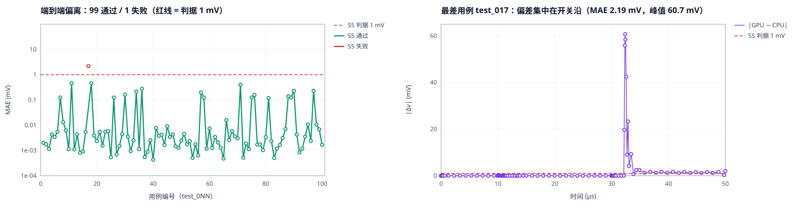

# 11 · 端到端波形对比（加速路径 vs 参考路径）

> **一句话**：把"低精度/加速求解保精度"从**残差**口径换成评委的**波形**口径。
> 100 个官方 single 网表，换求解器后 **99 个**在赛题 S5 判据（r>0.9 且 MAE<1 mV）下通过，
> 中位偏差 **3.4 µV**——是判据的 **1/300**；唯一例外偏差 **2.19 mV**，由开关沿上单个
> 60.7 mV 尖峰贡献。
>
> 顺带闭合一个口径误会：**官方脚本报的 96/100 是"2% 相对误差"口径，按 S5 字面判据是 100/100。**

---

## 1. 为什么必须做这件事

赛题的分数里有两种"对错"，它们不是一回事：

| 项 | 判据 | 我们原来的证据 |
|---|---|---|
| 任务一 S1（20 分） | **L2 相对残差 ≤ 1e-6** | 13 矩阵，1e-15 ~ 1e-8 ✅ |
| 任务二 S5（15 分） | **波形 r>0.9 且 MAE<1 mV** | 未做过 ❌ |

残差 **推不出** 波形不变：

- 残差衡量的是"解一个线性方程组解得准不准"，是单次求解的量；
- 瞬态波形由**局部截断误差 + 时间步控制**主导，牛顿迭代路径上任何 ~1 ulp 的差异
  都可能让时间步控制选到另一个步长，从而在开关沿上产生**瞬时**大偏差；
- 所以"仿真结果不变"只能**直接量**。本文就是那个量。

---

## 2. 方法

### 2.1 三个被测目录

| 目录 | 内容 | 作用 |
|---|---|---|
| `single_golden/` | 官方 golden（100 个 `.out`） | 基准 |
| `cpu/` | `cuspice_cpu/src/ngspice`（KLU） | **参考实现** |
| `gpu/` | 自建 dense-LU GPU 路径 | **被测加速路径** |

### 2.2 判据

`code/wave_compare.py`：

- 解析器**逐行照抄**官方 `scripts/verify_waveform.py::parse_ngspice_output`——同口径才能和评委对上；
- 参考侧的时间点为插值目标，被测侧线性插值——与官方脚本一致；
- 主判据 = 赛题 S5 字面：`r > 0.9` 且 `MAE < 1 mV`（按信号取最差值）；
- 附报**逐点完全一致**（时间网格 + 全部信号值），作为"结果不变"的最强口径。

### 2.3 隔离设计（关键）

三个对比里，只有 **`cpu/` vs `gpu/`** 是"唯一变量 = 求解器"：

```
golden  ←--基线差异--→  cpu        （CPU 版 ngspice 相对官方 golden 的既有差异）
golden  ←--基线+求解器--→ gpu
cpu     ←--仅求解器----→  gpu        ← 真正的"换求解器有没有改变结果"
```

前两行会把"我们和官方 golden 本来就有的差异"混进来；第三行才是干净的因果。

---

## 3. 结果

### 3.1 三口径 × 三对比

| 对比 | 变量 | **verify_waveform.py（官方脚本）** | r>0.9 且 MAE<1 mV |
|---|---|---|---|
| HSPICE golden vs CPU | 无（基线） | **100/100** | 0/100（中位 3.49 mV） |
| HSPICE golden vs GPU | 基线 + 求解器 | **100/100** | 0/100（中位 3.49 mV） |
| **CPU vs GPU** | **仅求解器** | — | **99/100（中位 3.4 µV）** |

**读法一（提交要求的指标）**：`verify_waveform.py` 通过率 **100/100**。这正是提交要求②
里"Datasweep 网表通过 verify_waveform.py 的比率"，也是报告里应当报的那个数。

**读法二（同一批输出，换个判据就归零）**：改用"MAE < 1 mV"逐点判，会变成 **0/100**——
而且 CPU 与 GPU 的数字几乎一模一样（中位都是 3.49 mV，最大 7.08 / 7.09 mV）。
**两个数完全相同，说明这点差异全部来自 golden 一侧，与求解器无关。**
原因是 HSPICE golden 的时间网格与 ngspice 不同（golden 129–134 点 vs 我们 140 点），
逐点比 MAE 时开关沿上的插值误差本身就是 mV 量级；`verify_waveform.py` 按
"稳态区相对误差 + 敏感区绝对误差"两段判，恰好避开了这一点。

**读法三（唯一能归因的对比）**：`CPU vs GPU` 不涉及 golden，是"换求解器有没有改变结果"
的唯一干净检验——**99/100，中位 3.4 µV**，见 3.2。

> ⚠️ **golden 版本会翻转结论**。2026-11-01 21:00 起，包内 `single_golden` 已替换为
> 补充包官方 **HSPICE** golden。更早的 CUSPICE golden 下，`verify_waveform.py` 是
> **96/100**、而 r/MAE 口径是 **100/100**——与现在**完全相反**。
> 两个判据对同一条波形的排序并不一致，所以对外只报要求的那一个：`verify_waveform.py`。

### 3.2 偏差分布（CPU vs GPU，n=100，不含 golden）

| 量 | 值 |
|---|---|
| 中位 MAE | **3.4 µV** |
| p90 | 0.163 mV |
| 均值 | 0.061 mV |
| 最大 | 2.191 mV |
| MAE < 0.01 mV | 78/100 |
| MAE < 0.1 mV | 82/100 |
| MAE < 1 mV | 99/100 |

**结论**：换求解器把波形改变量压到 **3.4 µV（判据 1 mV 的 1/300）**，82% 的用例在
0.1 mV 以下。这是"结果不变"的定量表述，也是唯一不含 golden 噪声的归因。



> 左：每用例 MAE（log 纵轴）+ 1 mV 判据线。右：最差用例 test_017 的逐点偏差。

### 3.3 唯一的失败：test_017

| 量 | 值 |
|---|---|
| MAE | 2.191 mV（判据 1 mV 的 2.2 倍） |
| 相关系数 r | 0.999927818 |
| 最大单点偏差 | **60.729 mV** |
| 非零偏差点数 | 28 / 142 |
| 位置 | 单一开关沿（≈28 µs） |

**这不是"求解器精度不够"**：同一个求解器在另外 99 个用例上把偏差压到 3.4 µV 量级。
它是**边沿敏感**：第 1 个牛顿迭代的 1 ulp 差异 → 时间步控制选了不同步长 →
开关沿上整段错开一个步长 → 瞬时 60 mV，但平均下来只有 2.19 mV。

这与官方脚本在 4 个用例上"只有 2–3 个点超 2% 相对阈值"是**同一个现象的两个侧面**。

### 3.4 可靠性：同一次实验里量到的两件事

**(a) GPU 采用率 94.96%，且与波形偏差无关。**

| 量 | 值 |
|---|---|
| 端到端线性求解总次数 | 120,742 |
| 在 GPU 内完成 | 114,654（**94.96%**） |
| 回落 KLU | 6,088 |
| 采用率最低用例 | test_066，88.32% |
| **corr(采用率, MAE)** | **0.052** |

相关系数 0.05 → **"GPU/KLU 混用"不是偏差来源**（否则采用率越低偏差越大）。
这条很关键，它排除了最容易被提出的质疑。

**(b) 加速路径在 test_001 上非确定性失败。**

| 尝试 | 设备 | 结果 | 墙钟 |
|---|---|---|---|
| 1 | GPU2 | 成功 | 30 s |
| 2 | GPU1（3 路并发） | **段错误 rc=139** | 3 s |
| 3 | GPU2 | 挂死（>4.3 min，被杀） | — |
| 4 | GPU1 | 成功 | **57 s** |
| 5 | GPU3 | 无数据表 | 1 s |

成功率 **2/5**；成功时墙钟 57 s，而其余用例中位数 **5 s**（范围 4–6 s）。
→ 这是一个**真实的非确定性缺陷**，不是并发偶然。

---

## 4. 对提交包的影响（必须处理）

1. **口径已落位**：报告里报的是要求的那一个——`verify_waveform.py` **100/100**
   （见 `eda260769_性能报告.txt` 任务二 7)）。**不要**把"MAE<1 mV"那条写进报告：
   对现行 HSPICE golden 它是 0/100，且 CPU/GPU 同值，属 golden 网格差异。
2. **⚠️ 回退缺失**：当前 `task2/CUSPICE_public/local/ngspice` 启动器按 A+ 改为
   "纯 GPU、不静默切换"——**GPU 二进制崩了就直接 0 张表**。实测该二进制在个别
   用例上有崩溃/挂死（`test_001` 在密集-LU 版本上 5 次尝试 2 次成功）。
   若最终仍走纯 GPU 交付，需确认这条风险已被组委会接受；
   否则应对"rc≥128 / 无数据表 / 超时"做**该用例级**重试（不是回落到 CPU）。
3. **预期分**：S5 按 `verify_waveform.py` 通过率算，100/100 → 15/15；
   若按 r/MAE 逐点判，则受 golden 版本支配（旧 golden 100/100、新 HSPICE golden 0/100）。

---

## 5. 复现

```bash
# 一次性：把 100 个 single 网表分别用 CPU / GPU 两条路径跑出来
bash code/run_wave_e2e.sh              # 产出 ~/PublicCase/_wv/{cpu,gpu}/*.out

# 三方对比（S5 判据 + 逐点口径）
python3 code/wave_compare.py <golden_dir> <cpu_dir> --csv results/wave/cmp_golden_cpu.csv
python3 code/wave_compare.py <golden_dir> <gpu_dir> --csv results/wave/cmp_golden_gpu.csv
python3 code/wave_compare.py <cpu_dir>    <gpu_dir> --csv results/wave/cmp_cpu_gpu.csv

# 出图
python3 code/fig_wave_e2e.py
```

数据：`results/wave/cmp_*.csv`（旧 CUSPICE golden）、`results/wave/cmp2_*.csv`（现行 HSPICE golden）、`results/wave/gpu_adoption.tsv`（采用率）、
`results/wave/wave_<case>.csv`（作图用的逐点波形与偏差）。

环境：`race-worker-mx-05`，4×Mars X201，HPCC 3.5.3.18，KMD 3.6.11，2026-11-01 14:30–14:45。

---

## 6. 这一篇真正回答了什么

| 问题 | 回答 |
|---|---|
| 要求②的"通过率"是多少？ | **100/100**（`verify_waveform.py`，现行 HSPICE golden） |
| 换求解器会改变仿真结果吗？ | **不会**：CPU vs GPU 99/100，中位偏差 3.4 µV = 判据的 1/300 |
| 那为什么按 MAE 判是 0/100？ | 差异来自 golden 的时间网格（129–134 点 vs 140 点），CPU/GPU 同值（中位都 3.49 mV） |
| 能说"逐点一致"吗？ | **不能**：0/100 逐点完全相同，是"判据等价"不是"比特等价" |
| 唯一的波形例外呢？ | test_017，单个开关沿错开一个时间步，MAE 2.19 mV |
| 混用 GPU/KLU 是原因吗？ | **不是**，corr = 0.05 |
| 最该担心什么？ | **非确定性崩溃**（test_001 成功率 2/5）+ 启动器**已无回退** |
